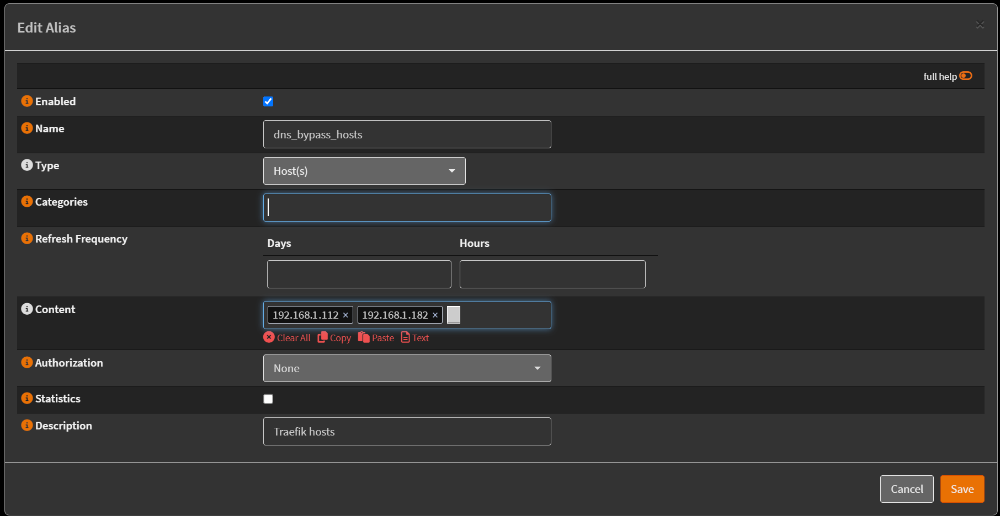
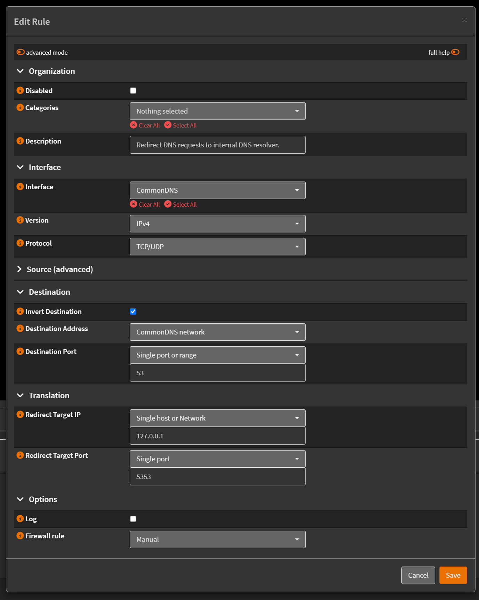
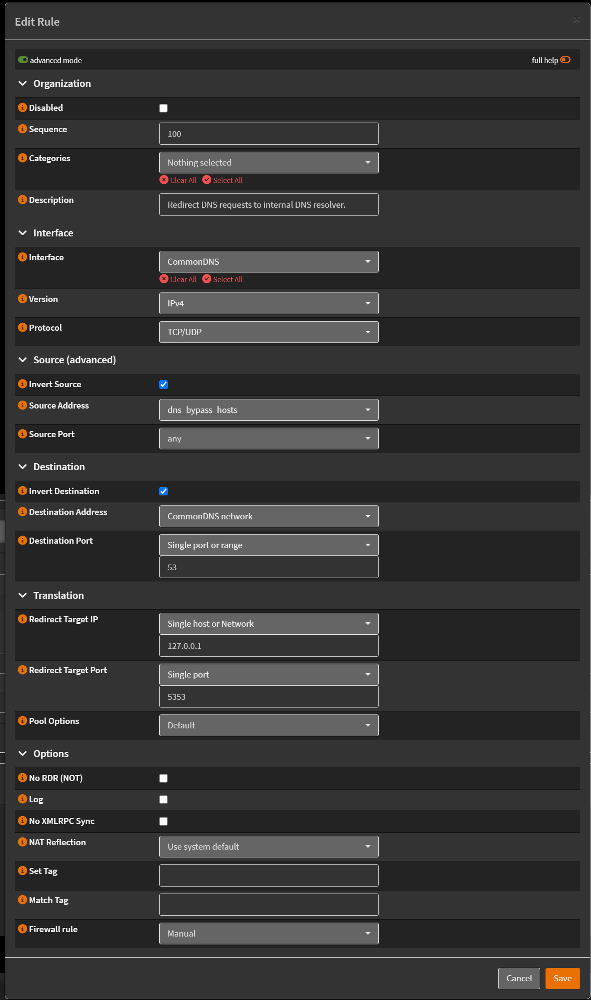

Some people who use OPNsense, a UDM or another advanced firewall as their router cannot finish the Traefik staging step. On OPNsense the cause is a DNS redirect rule. This page shows how to exempt your Docker host from it, and how to find the exact error if that is not enough.

## Symptoms

You run **Proxy** > **Traefik** > **Staging**. Deployrr shows "Monitoring traefik logs for progress (this can take up to 15 min)...", then stops with:

```txt
Unable to obtain ACME certificate
```

Deployrr adds two hints with it. One is about the Cloudflare API token. The other says: "If you have an advanced firewall (UDM, OPNsense, etc.), disable Ad Blocking and suspicious activity blocking or bypass it for the Docker host."

People on OPNsense have seen this even when all of these are true:

- Cloudflare has an A record for your domain that points to your public IP.
- Cloudflare has a wildcard CNAME record (`*.YOUR_DOMAIN`).
- Your port forwards are set up.
- Zenarmor is turned off. Turning it off did not help.

## Cause

Traefik gets certificates from Let's Encrypt with a DNS challenge. It adds a temporary TXT record in Cloudflare, then checks that the record can be seen before it asks Let's Encrypt to validate it. For this check, Traefik sends DNS queries on port 53 straight to servers outside your network. First it asks `1.1.1.1:53` and `1.0.0.1:53`, which are set in the Traefik compose file (`compose/HOSTNAME/traefik.yml` in your Docker folder), for your domain's Cloudflare nameservers. Then it asks those nameservers directly for the TXT record. It does this whatever DNS server your network normally hands out.

To see this check happen in the Traefik log, watch [Traefik 3 guide: waiting for the DNS records to propagate at 45:55](https://youtu.be/KMZIyoZ3jWM?t=2755) (manual Docker Compose setup, Deployrr does these steps for you).

On OPNsense, the cause is a DNS redirect rule. Many people set OPNsense to redirect (hijack) every DNS request on the LAN to its own resolver. Then Traefik's queries never leave your network. The rule rewrites them to your local resolver, for example Unbound. Your local resolver is not Cloudflare's nameserver. It usually refuses Traefik's direct question to the nameserver, or answers from its cache. Either way, Traefik never sees the new record, and the check times out.

This is also why the `1.1.1.1` setting in Traefik does not help on its own. Those queries go to port 53 too, so the redirect catches them as well. The Docker host has to be left out of the redirect.

On other advanced firewalls, ad blocking and "suspicious activity" blocking can do the same, as Deployrr's hint says.

## Fix on OPNsense: exempt the Docker host from the DNS redirect

Keep the redirect for the rest of your network. Only the server that runs Traefik skips it. The screenshots below are from OPNsense 26.x.

1. In OPNsense, go to **Firewall** > **Aliases** and add an alias:
   - **Type**: Host(s).
   - **Name**: any name you like, for example `dns_bypass_hosts`.
   - **Content**: the IP address of your Docker host, the server that runs Deployrr and Traefik. Containers on normal Docker networks use the host's IP address, so this covers Traefik. If a container has its own IP address on your LAN (a macvlan or ipvlan network) and needs real outside DNS, add that IP too.

   Give every IP in the alias a static address or a DHCP reservation, so the exemption does not move to another device. Save, then select **Apply**.

   

   This example alias holds two hosts. Yours may have only one.

2. Go to **Firewall** > **NAT** > **Destination NAT** (on some versions **Port Forward**). Find the rule that redirects DNS requests (port 53) to your local resolver. It often has a description like "Redirect DNS requests to internal DNS resolver". It catches port 53 traffic on one of your LAN or VLAN interfaces and sends it to `127.0.0.1`, on the port your local resolver listens on.

   For example, on an interface named `CommonDNS` (here an interface group that holds the LAN interface), the destination reads `! CommonDNS network` with port 53. That means "DNS going anywhere outside this network". `CommonDNS` is only an example name. Your rule's description, interface and redirect port depend on how you set it up.

   

   In this example, the redirect target is Unbound on `127.0.0.1` port `5353`.

3. Open that rule. The source settings are under **Source (advanced)**, which is closed by default (as in the screenshot). Open it, tick **Invert Source** and set **Source Address** to the alias from step 1. Leave **Source Port** at `any`. The source then shows as `! dns_bypass_hosts` (with your alias name). This means "every device except the Docker host". Leave the inverted destination as it is.

   

   This screenshot has **advanced mode** switched on, so it shows a few more fields (such as **Sequence** and **NAT Reflection**). You don't need to change them.

4. Save the rule, then select **Apply**.
5. Run the staging step again (see [Try staging again](#try-staging-again)).

Menu names can differ a little between OPNsense versions.

The redirect only catches IPv4 DNS. If your network also uses IPv6 and you have a matching IPv6 redirect rule, exempt the Docker host in that rule too.

### Do you need a firewall rule for the redirect?

Some guides add a firewall pass rule next to the NAT rule, for example one that allows `! dns_bypass_hosts` to `127.0.0.1` port `5353`. That rule is not part of this fix. The exemption that helps Traefik is the one in the NAT rule.

OPNsense rewrites the address before its firewall rules check the traffic, so the rules see a query to `127.0.0.1`. The default "Default allow LAN to any" rule already allows that from your LAN. If your redirect only covers your LAN and that default rule is still there, the extra pass rule changes nothing. You can disable it instead of deleting it, in case you tighten your LAN rules later.

Keep a pass rule if:

- You removed or narrowed the default LAN allow rule.
- The redirect also runs on a VLAN with no allow-all rule, such as an IoT or guest network.

In those cases, you can also set **Firewall rule** to **Pass** in the NAT rule (on older versions, **Filter rule association**). Redirected traffic then skips the firewall rules, so you need no separate rule.

:::caution
Changing firewall and DNS rules can cut off DNS for other devices on your network. Write down the old setting first, change one rule at a time and test after each change.
:::

## Fix on other firewalls

1. Follow Deployrr's hint. In your firewall, turn off ad blocking and suspicious activity blocking for your Deployrr server, or add the server to a bypass list.
2. Look for any rule that redirects or blocks DNS (port 53) from your Deployrr server, and exempt the server from it, as in the OPNsense steps.
3. Run the staging step again (see [Try staging again](#try-staging-again)).

## Find the real error

If staging still fails, these checks show what is going on.

1. Read the ACME error in the Traefik log. Run this from your Docker folder:

   ```bash
   grep -i acme logs/$HOSTNAME/traefik/traefik.log | tail -n 20
   ```

   Bash fills in `$HOSTNAME` for you. Staging clears this log each time it starts, so check it right after a failed attempt. Look for words such as `propagation`, `timeout`, `NXDOMAIN` or `authorization`. See [Read the Traefik logs](/reverse-proxy/check-traefik-logs/) if you need help finding the file.

2. Check that your server can reach your domain's Cloudflare nameservers directly, the same way Traefik does. Replace `YOUR_DOMAIN` with your own domain. First, find the nameservers:

   ```bash
   dig +short NS YOUR_DOMAIN
   ```

   If `dig` is not installed, install it with `sudo apt install dnsutils`. You get two names that end in `ns.cloudflare.com`. Ask one of them directly, with your own nameserver name in place of `NAME`:

   ```bash
   dig +norecurse TXT _acme-challenge.YOUR_DOMAIN @NAME.ns.cloudflare.com
   ```

   Look at the `flags:` line in the output. If it includes `aa` (authoritative answer), the query reached Cloudflare. If the status is `REFUSED`, or `aa` is missing, something on your network redirected the query. If it times out, the query is being blocked.

   :::note
   A plain `dig TXT _acme-challenge.YOUR_DOMAIN @1.1.1.1` is not a good test here. It still works while a DNS redirect is active, because your local resolver answers and `dig` still shows `1.1.1.1` as the server.
   :::

3. In OPNsense, also check **Services** > **Unbound DNS** for blocklist settings, and your firewall rules for anything that blocks outbound port 53 for your server.

### Try staging again

Run **Proxy** > **Traefik** > **Staging** again. Deployrr warns that a previous setup may be overwritten. Press `Y` to continue. If it asks "Reuse existing staging SSL certificate?", press any key other than `Y` so you get a fresh attempt.

### Other staging errors

Deployrr can stop staging with other messages. Each has its own fix. [Traefik can't get a Let's Encrypt certificate](/reverse-proxy/certificate-errors/) covers each one in more detail:

- **Failed to find zone**: the Cloudflare API token is wrong. It needs Zone / Zone / Read and Zone / DNS / Edit.
- **Could not find DNS validation TXT record**: delete all `_acme-challenge` TXT records in Cloudflare and try again.
- **Cannot get ACME client get directory. Possible DNS server issue.**: check the DNS servers on your router, and check that the server has internet access. The checks in [Find the real error](#find-the-real-error) help here too.
- **Getting certificate failed with error 429**: Let's Encrypt's rate limit. Wait 24 hours before you try again.

### If nothing works: use Tailscale

If you only need to reach your apps from outside your home, you can use [Tailscale](/networking/tailscale/) instead of Traefik certificates. Tailscale is in Deployrr under **Apps** > **Browse Apps**. It needs the network adapter set up first (**System** > **Network**).

During the install, the **Tailscale - Configuration** box asks for your Tailscale auth key. Deployrr then recommends that you turn off MagicDNS in the Tailscale admin console. Otherwise, the Docker host can lose internet access. After install, you open apps at `TAILSCALE-IP:PORT`.

This avoids the problem. It does not fix it. You still do not get HTTPS addresses on your own domain.

## Check it worked

1. `dig +norecurse TXT _acme-challenge.YOUR_DOMAIN @NAME.ns.cloudflare.com` shows the `aa` flag and no `REFUSED` status.
2. **Proxy** > **Traefik** > **Staging** finishes without the error.
3. The Traefik log has no new `unable to obtain ACME certificate` lines.

When staging works, a browser shows a "Not Secure" warning for your domain. Deployrr says this is normal for a staging certificate. The next step is **Proxy** > **Traefik** > **Production**. See [Set up Traefik](/reverse-proxy/traefik-setup/) for the whole setup.
